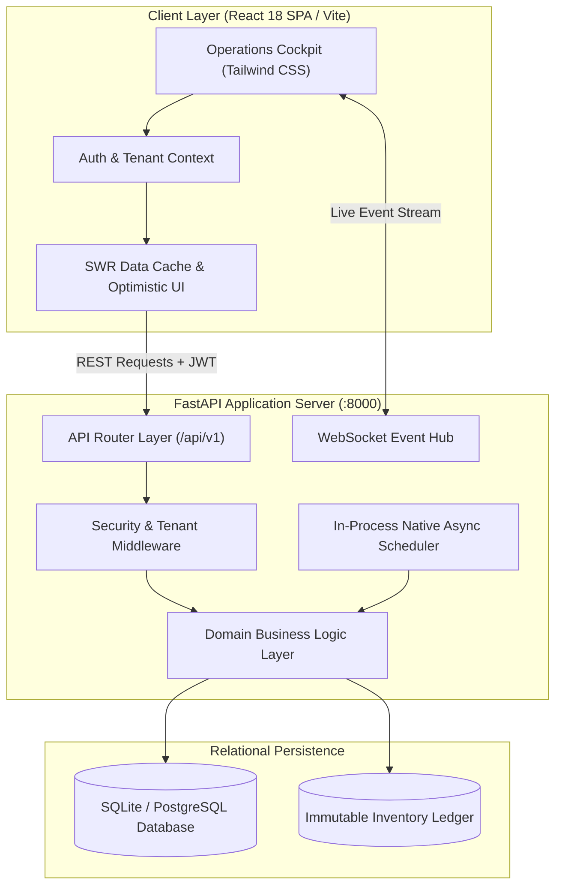
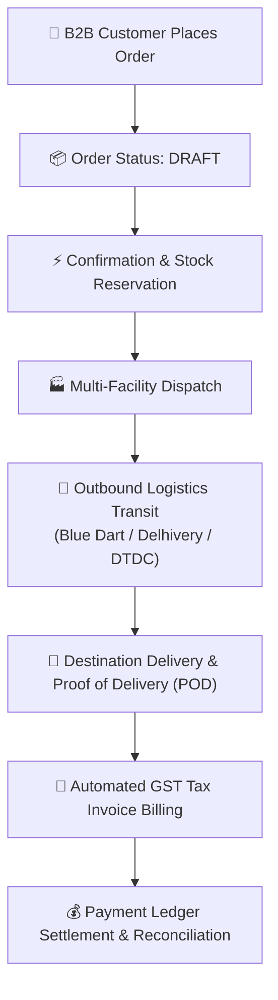

# FlowStock — System Architecture & Technical Specification

> [!NOTE]
> FlowStock is a financial-grade, multi-tenant B2B inventory ledger and operations platform engineered for high-velocity physical supply chains. Reference: [README.md](README.md)

---

## 🏗️ 1. Tech Stack Overview

| Layer | Technologies | Rationale |
| :--- | :--- | :--- |
| **Frontend Cockpit** | React 18, Vite 8, Tailwind CSS 3.4, Framer Motion, SWR | Instant client-side routing, GPU-accelerated micro-interactions, responsive data density, zero-layout-shift skeleton loaders. |
| **Backend API** | FastAPI (Python 3.10+ / 3.13), Pydantic v2 | High-concurrency async I/O, automatic OpenAPI / Swagger generation, strict runtime schema validation. |
| **Persistence Layer** | SQLAlchemy 2.0 Async, SQLite (Local Dev) / PostgreSQL (Prod) | Pure asynchronous session management, declarative relational mapping, automated schema migrations with Alembic. |
| **Authentication & Tenancy** | JWT Bearer Tokens, Tenant Header Resolution (`X-Organization-Id`) | Complete row-level tenant segregation (`organization_id`), pre-seeded multi-role RBAC. |
| **Real-Time Layer** | FastAPI Native In-Memory WebSockets (`/api/v1/ws`) | Zero-Redis dependency for local development, instant low-stock notifications and order status broadcasts. |

---

## 📐 2. High-Level Architectural Topology



---

## 🔄 3. End-to-End Operational Lifecycle & State Machines

FlowStock choreographs physical supply chains from initial procurement to tax invoice settlement:



### Core State Machines
1. **Sales Order Lifecycle**:  
   `DRAFT` &rarr; `CONFIRMED` &rarr; `ALLOCATED` &rarr; `DISPATCHED` &rarr; `DELIVERED` &rarr; `CANCELLED`
2. **Purchase Order Lifecycle**:  
   `DRAFT` &rarr; `SUBMITTED` &rarr; `PARTIALLY_RECEIVED` &rarr; `RECEIVED` &rarr; `CLOSED`
3. **Inter-Warehouse Transfer Lifecycle**:  
   `REQUESTED` &rarr; `IN_TRANSIT` &rarr; `RECEIVED` / `CANCELLED`
4. **Shipment Lifecycle**:  
   `PENDING` &rarr; `PICKED_UP` &rarr; `IN_TRANSIT` &rarr; `OUT_FOR_DELIVERY` &rarr; `DELIVERED` &rarr; `EXCEPTION`
5. **Tax Invoice Lifecycle**:  
   `DRAFT` &rarr; `ISSUED` &rarr; `PARTIALLY_PAID` &rarr; `PAID` &rarr; `OVERDUE` &rarr; `VOID`

---

## 🔒 4. Multi-Tenant Security & RBAC Enforcement

### Row-Level Data Isolation
Every core table incorporates an `organization_id` foreign key. The `get_current_tenant` dependency in `backend/app/api/deps.py` enforces tenant context:
```python
# Automatic tenant isolation filter in repository queries
stmt = select(Product).where(Product.organization_id == tenant.id)
```

### Role-Based Access Control (RBAC) Matrix
- **Admin (`admin`)**: Complete organization management, user provisioning, database settlement, invoice voiding.
- **Warehouse Manager (`warehouse_manager`)**: Catalog management, ledger movements, facility transfers, order fulfillment.
- **Sales Representative (`sales_rep`)**: Customer accounts, sales orders, purchase orders, invoice generation.
- **Auditor / Viewer (`viewer`)**: Read-only observation across all operational cockpits with audit trail inspection.

---

## 📊 5. Append-Only Inventory Ledger Model

Unlike standard CRUD systems that directly update `quantity` fields, FlowStock utilizes a **double-entry append-only inventory ledger**:
- Direct mutations to stock balances are prohibited.
- Every inventory modification creates an immutable movement record:
  - `DEBIT`: Stock deducted from warehouse (Sales order fulfillment, outbound transfer dispatch).
  - `CREDIT`: Stock added to warehouse (Purchase order receipt, inbound transfer arrival, return adjustment).
- Real-time balances are calculated by aggregating historical movements, guaranteeing full auditability and preventing phantom inventory loss.

---

## ⚡ 6. Tier-1 MNC Frontend Architectural Standards

FlowStock's frontend adheres to strict enterprise design patterns:
1. **Zero-Overhead CSS Styling**: Eliminated JavaScript mouse-coordinate tracking on cards. Cards use pure CSS GPU-accelerated hover transitions.
2. **Instant Navigation**: Replaced artificial timer-based route progress bars with instant view transitions and skeleton placeholders (`Skeleton.jsx`).
3. **Enterprise Compliance Model**: Eliminated floating consumer-style consent banners that trigger corporate ad-blockers (Brave Shields, uBlock Origin). All compliance terms are anchored directly into login authentication and `/settings`.
4. **Standardized Currency Localization**: Strict adherence to Indian Rupee (`₹ INR`) formatting via centralized `formatINR()` utilities.