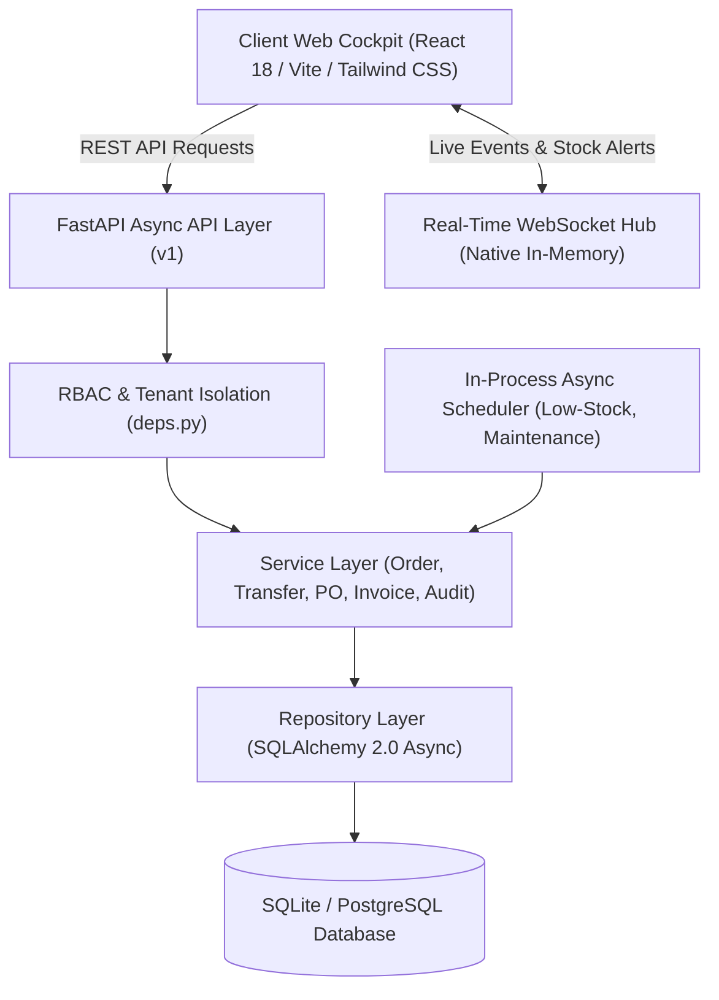

# FlowStock — Multi-Tenant B2B SaaS Operations Platform

[](LICENSE)
[](https://python.org)
[](https://fastapi.tiangolo.com)
[](https://react.dev)
[](https://vitejs.dev)
[](https://tailwindcss.com)
[](backend/tests/)
[](#architecture)

FlowStock is an enterprise-grade, multi-tenant B2B operations cockpit engineered for manufacturers, distributors, and logistics operations. It provides end-to-end management of inventory ledgers, multi-facility warehouse stock transfers, sales orders, purchase procurement, outbound shipments, tax invoicing with payment settlement, real-time WebSocket notifications, and strict Role-Based Access Control (RBAC).

---

## 🚀 Key Highlights & Architectural Mandates

- **Free-Only Mandate**: Zero paid cloud services, zero credit card requirements, and zero vendor lock-in.
- **Zero-Docker Local Development**: Runs natively on Windows, macOS, or Linux using standard Python and Node.js toolchains without container overhead.
- **Zero-Redis Simplicity**: Real-time events operate via FastAPI in-memory WebSockets; background jobs run on an in-process native async task scheduler.
- **Tier-1 MNC Enterprise UI**: Clean, high-performance UI architecture without consumer-style gimmicks, floating popups, or mouse-tracking overhead.
- **Indian Rupee (₹ INR) Standard**: Native currency localization (`formatINR`) across all financials, orders, POs, and analytics.
- **Strict Multi-Tenant Isolation**: Row-level tenant partitioning (`organization_id`) enforced across all queries and services, verified with automated anti-masquerading tests.
- **Append-Only Inventory Ledger**: Stock changes are strictly recorded as immutable debit/credit movement records—never direct database mutations.

---

## 📐 Architecture



---

## ⚡ Quickstart (1-Click Automation)

### Windows (PowerShell)
Clone the repository and run the setup script:
```powershell
powershell -ExecutionPolicy Bypass -File .\setup.ps1
```
Launch both the backend and frontend servers in separate windows:
```powershell
.\start.ps1
```

### macOS / Linux (POSIX)
Clone the repository, grant executable permissions, and run setup:
```bash
chmod +x setup.sh start.sh
./setup.sh
```
Launch both services:
```bash
./start.sh
```

---

## 🛠 Manual Setup Guide

If you prefer to configure and run the components manually:

### 1. Environment Configuration
```bash
# Root backend configuration
cp .env.example .env

# Frontend configuration
cp frontend/.env.example frontend/.env.local
```

### 2. Backend Setup (FastAPI)
```bash
# Windows
python -m venv backend/venv
.\backend\venv\Scripts\Activate.ps1
python -m pip install --upgrade pip
pip install -r backend/requirements.txt

# macOS / Linux
python3 -m venv backend/venv
source backend/venv/bin/activate
pip install --upgrade pip
pip install -r backend/requirements.txt
```

### 3. Initialize Database & Seed Demo Data
```bash
# Run database schema creation and seed organizations, products, warehouses, and users
python -m app.core.seed
```

### 4. Frontend Setup (React + Vite)
```bash
cd frontend
npm install
```

### 5. Start Development Servers
- **Backend**:
  ```bash
  # Windows (via standalone bat)
  .\backend\run_backend.bat

  # Or manually via Python module
  .\backend\venv\Scripts\python.exe -m uvicorn app.main:app --host 127.0.0.1 --port 8000 --app-dir backend --reload
  ```
- **Frontend**:
  ```bash
  cd frontend
  npm run dev
  ```
  *(Vite will automatically launch `http://localhost:3000` in your default browser).*

---

## 🌐 Service Endpoints

| Service | URL | Description |
|---|---|---|
| **Web Cockpit** | `http://localhost:3000` | React + Vite operations cockpit with real-time updates |
| **API Health** | `http://127.0.0.1:8000/api/v1/health` | Backend status & database connectivity check |
| **Swagger UI** | `http://127.0.0.1:8000/docs` | Interactive OpenAPI documentation & test sandbox |
| **ReDoc** | `http://127.0.0.1:8000/redoc` | Clean REST API specifications |
| **WebSocket** | `ws://127.0.0.1:8000/api/v1/ws` | Live event stream for orders, stock movements & alerts |

---

## 👥 Demo Organizations & Pre-Seeded Users

FlowStock includes two fully pre-seeded organizations with 4 distinct enterprise roles each:

### Tenant 1: Samsung Electronics Ltd (Slug: `samsung`)
| Name | Role | Email | Permissions |
|---|---|---|---|
| **Alice Admin** | `admin` | `alice@samsung.com` | Full administrative access, user provisioning, settlement, voiding |
| **Ramesh Warehouse** | `warehouse_manager` | `ramesh@samsung.com` | Inventory ledger adjustments, transfers, PO receiving, order fulfillment |
| **Vikram Sales** | `sales_rep` | `vikram@samsung.com` | Customer creation, sales order drafting & confirmation, invoice creation |
| **Pooja Auditor** | `viewer` | `pooja@samsung.com` | Read-only inspection across all cockpit views |

### Tenant 2: Samsung Semiconductor Ltd (Slug: `samsung-semi`)
| Name | Role | Email | Permissions |
|---|---|---|---|
| **Sunil Admin** | `admin` | `sunil@samsung-semi.com` | Full administrative authority for Samsung Semiconductor organization |
| **Bob Manager** | `warehouse_manager` | `bob@samsung-semi.com` | Semiconductor warehouse operations, stock movements, dispatches |
| **Kavita Sales** | `sales_rep` | `kavita@samsung-semi.com` | Sales order creation, OEM customer relations, invoicing |
| **Deepak Auditor** | `viewer` | `deepak@samsung-semi.com` | Read-only inspection across semiconductor operations |

*Demo Password (all accounts):* `admin123` (or switch instantly using the in-app role selector in the header).

---

## 🔒 Role-Based Access Control (RBAC) Matrix

| Resource & Action | HTTP Method | `admin` | `warehouse_manager` | `sales_rep` | `viewer` |
|---|---|:---:|:---:|:---:|:---:|
| **All Read Queries** (Catalog, Stock, Orders, Invoices) | `GET` | ✅ | ✅ | ✅ | ✅ |
| **Compliance Audit Trail** (`/audit`) | `GET` | ✅ | ❌ | ❌ | ❌ |
| **User Provisioning** (`/organizations/{id}/users`) | `POST` | ✅ | ❌ | ❌ | ❌ |
| **Warehouse Facility Creation** (`/warehouses`) | `POST` | ✅ | ❌ | ❌ | ❌ |
| **Catalog Management** (`/products`, `/categories`) | `POST/PUT` | ✅ | ✅ | ❌ | ❌ |
| **Stock Ledger Adjustments** (`/inventory/movements`) | `POST` | ✅ | ✅ | ❌ | ❌ |
| **Inter-Warehouse Transfers** (`/transfers/*`) | `POST` | ✅ | ✅ | ❌ | ❌ |
| **Purchase Order Receiving** (`/purchase-orders/*`) | `POST` | ✅ | ✅ | ❌ | ❌ |
| **Order Picking & Fulfillment** (`/orders/{id}/fulfill`) | `POST` | ✅ | ✅ | ❌ | ❌ |
| **Shipment Dispatches** (`/shipments/*`) | `POST` | ✅ | ✅ | ❌ | ❌ |
| **Customer Management** (`/customers`) | `POST/PUT` | ✅ | ❌ | ✅ | ❌ |
| **Sales Order Creation & Confirm** (`/orders/*`) | `POST` | ✅ | ❌ | ✅ | ❌ |
| **Invoice Generation** (`/invoices`) | `POST` | ✅ | ❌ | ✅ | ❌ |
| **Invoice Settlement (Payments)** (`/payments`) | `POST` | ✅ | ❌ | ❌ | ❌ |
| **Invoice Cancellation / Voiding** (`/invoices/{id}/void`) | `POST` | ✅ | ❌ | ❌ | ❌ |

---

## 🧪 Automated Testing Suite

FlowStock features an exhaustive automated test suite covering unit logic, service integration, multi-tenant isolation, and end-to-end business workflows:

```bash
# Run the complete test suite with execution durations
pytest backend/tests/ -v --durations=10
```

### Test Suite Breakdown (70 Total Tests)
- `test_auth_tenancy.py`: Organization provisioning, tenant header resolution, data isolation between tenants.
- `test_products_categories.py`: Product catalog, SKU uniqueness, search, filtering, category taxonomy.
- `test_inventory_ledger.py`: Append-only movements, negative stock prevention, stock balance reconstruction.
- `test_warehouses_transfers.py`: Multi-facility transfer state machine (Requested → In Transit → Received / Cancelled).
- `test_customers_orders.py`: Sales order lifecycle, inventory reservation, order fulfillment.
- `test_suppliers_purchasing.py`: Supplier management, purchase order goods receipt, automatic ledger credits.
- `test_shipments.py`: Outbound logistics, tracking numbers, milestone checkpoint event logging.
- `test_invoicing_payments.py`: Tax calculations, payment allocations, partial payments, status transitions.
- `test_analytics_dashboard.py`: Inventory valuation, revenue tracking, low-stock alerts.
- `test_audit_notifications.py`: Immutable audit logging, real-time user notifications.
- `test_background_jobs.py`: Scheduled low-stock alerts, stale order cancellations, manual job execution.
- `test_websockets.py`: Real-time WebSocket connection handling, tenant broadcasting, event serialization.
- `test_e2e_workflow.py`: Complete end-to-end commerce lifecycle test.
- `test_security_rbac.py`: RBAC enforcement, cross-tenant anti-masquerading, secret key validation.
- `test_performance.py`: N+1 query elimination verification, compound index registration, and dashboard latency benchmarks.

---

## 📁 Repository Structure

```
Flow-Stock/
├── .github/
│   └── workflows/
│       └── ci.yml                 # GitHub Actions CI pipeline
├── backend/
│   ├── app/
│   │   ├── api/
│   │   │   ├── deps.py            # Authentication, RBAC & tenant resolution
│   │   │   └── v1/
│   │   │       ├── api.py         # Main router aggregator
│   │   │       └── endpoints/     # Feature endpoint modules (auth, orders, etc.)
│   │   ├── core/
│   │   │   ├── config.py          # Environment settings & validation
│   │   │   ├── database.py        # SQLAlchemy async engine & session maker
│   │   │   ├── scheduler.py       # Native async background task scheduler
│   │   │   ├── security.py        # Password hashing & JWT utilities
│   │   │   ├── seed.py            # Automated demo data seed
│   │   │   └── websocket.py       # In-memory WebSocket connection manager
│   │   ├── models/                # SQLAlchemy ORM entity models
│   │   ├── repositories/          # Data access layer
│   │   ├── schemas/               # Pydantic validation schemas
│   │   └── services/              # Domain business logic layer
│   ├── tests/                     # Comprehensive pytest test suite (70 tests)
│   ├── run_backend.bat            # 1-click Windows backend launcher
│   ├── alembic.ini                # Migration configuration
│   └── requirements.txt           # Python dependencies
├── frontend/
│   ├── src/
│   │   ├── components/            # UI primitives (Cards, Tables, Steppers, Modals)
│   │   ├── context/               # TenantContext, AuthContext, ThemeContext
│   │   ├── hooks/                 # Reusable domain and state hooks
│   │   ├── lib/                   # API client, SWR config, formatting utils
│   │   ├── pages/                 # Full feature views (Orders, Inventory, Invoices)
│   │   ├── App.jsx                # Router & Provider hierarchy
│   │   └── main.jsx               # Application entrypoint
│   ├── package.json               # Node.js dependencies
│   ├── vite.config.js             # Vite configuration with auto-open
│   └── tailwind.config.js         # Design tokens & styling
├── .env.example                   # Environment configuration template
├── .gitignore                     # Git ignore rules (secrets, venv, caches)
├── Project Architecture.md        # Comprehensive system design blueprint
├── setup.ps1                      # Windows automated setup script
├── start.ps1                      # Windows dual server launcher
├── setup.sh                       # POSIX automated setup script
├── start.sh                       # POSIX dual server launcher
└── README.md                      # Project documentation
```

---

## 📄 License

This project is licensed under the MIT License — see the [LICENSE](LICENSE) file for details.
